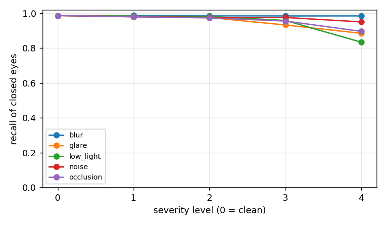

# Eye CNN evaluation (R4)

Model: `/kaggle/working/eye_cnn/best.pt`

## 1. MRL Eye, unseen test people

| group | n | n_people | accuracy | acc_ci_low | acc_ci_high | f1_closed | recall_closed | auroc | ece | person_acc_min | person_acc_median | flag |
|---|---|---|---|---|---|---|---|---|---|---|---|---|
| overall | 20333 | 7 | 0.978 | 0.946 | 0.993 | 0.979 | 0.982 | 0.997 | 0.008 | 0.916 | 0.959 |  |
| dataset=mrl | 20333 | 7 | 0.978 | 0.946 | 0.993 | 0.979 | 0.982 | 0.997 | 0.008 | 0.916 | 0.959 |  |
| glasses=no | 13506 | 6 | 0.991 | 0.982 | 0.999 | 0.991 | 0.992 | 1.000 | 0.004 | 0.975 | 0.984 |  |
| glasses=yes | 6827 | 5 | 0.952 | 0.920 | 0.962 | 0.961 | 0.966 | 0.987 | 0.019 | 0.916 | 0.939 |  |
| reflection=high | 1386 | 4 | 0.957 | 0.863 | 0.980 | 0.957 | 0.942 | 0.987 | 0.027 | 0.842 | 0.923 | fewer than 5 people |
| reflection=low | 1102 | 6 | 0.920 | 0.901 | 0.985 | 0.951 | 0.908 | 0.996 | 0.038 | 0.899 | 0.982 |  |
| reflection=none | 17845 | 7 | 0.983 | 0.972 | 0.997 | 0.984 | 0.993 | 0.999 | 0.009 | 0.959 | 0.978 |  |
| lighting=bad | 16978 | 7 | 0.975 | 0.943 | 0.992 | 0.976 | 0.980 | 0.997 | 0.009 | 0.916 | 0.960 |  |
| lighting=good | 3355 | 6 | 0.990 | 0.986 | 0.999 | 0.993 | 0.992 | 0.999 | 0.004 | 0.875 | 0.994 |  |
| sensor=realsense | 20333 | 7 | 0.978 | 0.946 | 0.993 | 0.979 | 0.982 | 0.997 | 0.008 | 0.916 | 0.959 |  |

Worst condition with >= 5 people: **reflection=low** (recall of closed eyes 0.908).

## 2. Stress tests (recall of closed eyes by severity, held-out people)

| factor | L0 | L1 | L2 | L3 | L4 | first fails (>10 pt drop) |
|---|---|---|---|---|---|---|
| blur | 0.987 | 0.987 | 0.985 | 0.984 | 0.985 | - |
| glare | 0.987 | 0.982 | 0.975 | 0.933 | 0.885 | 4 |
| low_light | 0.987 | 0.982 | 0.981 | 0.959 | 0.834 | 4 |
| noise | 0.987 | 0.980 | 0.976 | 0.976 | 0.951 | - |
| occlusion | 0.987 | 0.979 | 0.973 | 0.955 | 0.897 | - |

